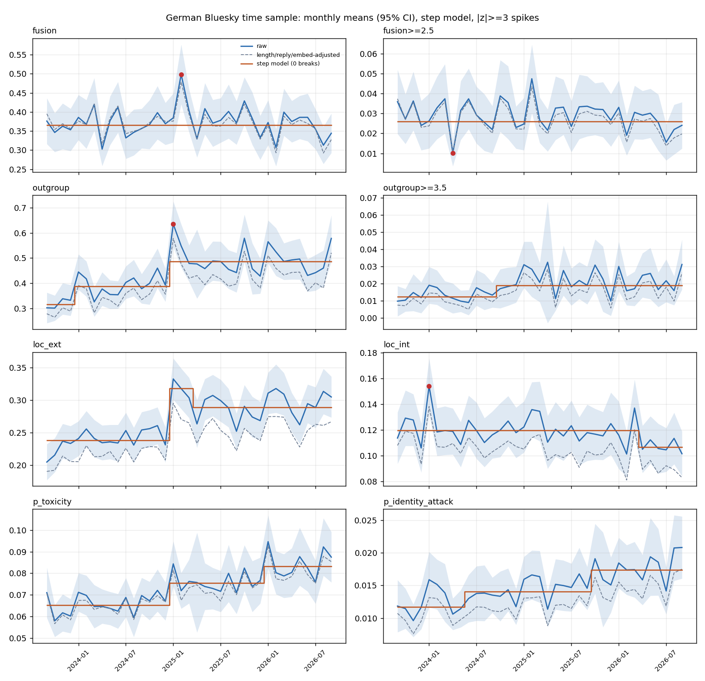
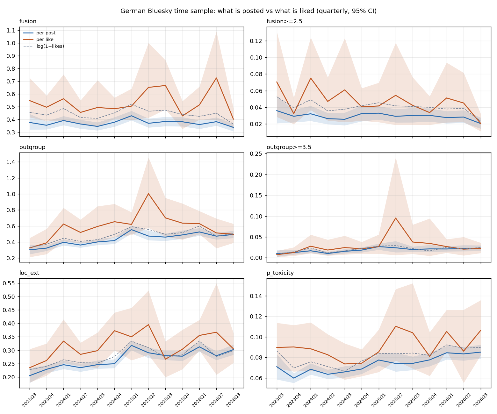

# Identity fusion and outgroup hostility on German Bluesky, 2023-09 – 2026-09

**Data.** The German time sample (`research/data/time_sample/time_sample_de.jsonl`,
`collect_time_sample.py --lang de`): ~1,000 uniformly drawn instants per month, one
post each, weighted for the length bias of the draw. Restricted to posts whose
*first* declared language is German and to 2023-09 on — in 2023-07/08 only 21% / 75%
of the `de`-tagged frame was German-first (multi-tag clients). n = 36,009 posts,
~970 per month.

**Measures.** One jev-latest request per post (`score_time_sample.py`, rubric
`fusion_questions.py`, version `fusion-v2`), $4.00 for 36,679 distinct texts:

* `fusion` — 0–9 Score. Identity fusion (Swann et al. 2009/2012): a felt oneness
  of personal and group self, the group's fate felt as one's own, members as kin,
  personal agency spent for the group. Seven of the ten levels sit *below* fusion
  proper (passing "we", membership label, shared activity, pride, protecting the
  group) because that is where a random sample lives: 79% of posts score 0, 13%
  level 1, 0.3% level 5 or above.
* `outgroup` — 0–8 Score, hostility toward a group: civil disagreement, mockery,
  blame, contempt, enemy/threat framing, dehumanisation, exclusion, violence. Kept
  separate from fusion because the risk literature (Ebner, Kavanagh & Whitehouse
  2024) treats the two as distinct factors whose combination is the dangerous case.
* LoC `loc_score` / `loc_class` / `agency`, riding in the same request.
* Perspective, 14 attributes: core six plus the `en`-only ones, *without* the
  bridging attributes (English-only) and without INCOHERENT / LIKELY_TO_REJECT
  (they score "not English" on German).

All numbers are weighted monthly means; trends and breaks are fitted on those
with their sampling variance (`timeseries_patterns.py`). Labels are a model's
output — jev for fusion/outgroup/LoC, Perspective for its attributes. Nothing here
is validated against human coding.



## 1. Identity fusion: flat level, shifting target

* **No trend.** Mean 0.366; a flat line beats a linear trend (slope −0.001/yr) and
  every step model on BIC. Same after adjusting for length, reply and embed, and
  for the share past the "passing we / label" levels (`fusion>=2.5`, 2.6%).
* **One spike: 2025-02**, 0.498 against 0.366 (z = 3.3; 2.7 after allowing for
  the series' overdispersion). Weekly, it runs from ISO week 5 (27 Jan – 2 Feb)
  through week 10, i.e. the run-up to the 23 Feb federal election. Political
  fusion targets double in that month: 33% of posts with fusion ≥ 1.5 vs 17% in
  all other months.
* **What people fuse with changes even though how much does not.** Among posts
  with fusion ≥ 1.5 (half-years, %):

  | | 2023H2 | 2024H1 | 2024H2 | 2025H1 | 2025H2 | 2026H1 |
  |---|---|---|---|---|---|---|
  | local / online community | 19 | 12 | 13 | 10 | 10 | 4 |
  | political camp | 6 | 16 | 15 | 25 | 14 | 20 |
  | nation / ethnic | 3 | 7 | 9 | 10 | 10 | 12 |
  | fandom / sports | 21 | 16 | 21 | 13 | 22 | 19 |

  The early platform's "this place / us here" belonging gives way to political
  and national belonging. (2023H2 here includes 2023-07/08, whose frame is partly
  non-German.)
* One significant dip, 2024-04 in `fusion>=2.5` (1.0%, z = −3.7 adjusted), spread
  over weeks 12–19 with no topical signature. Treat as unexplained.

## 2. Outgroup hostility: steps up, but mostly through who posts

* **Two level shifts**, both in January: 0.316 (2023-09..12) → 0.387 (2024) →
  0.487 (2025-01 on). Step model BIC 68 vs linear 86 vs flat 172. The breaks
  survive the composition adjustment (0.281 → 0.346 → 0.430). The share at insult
  or worse (`outgroup>=3.5`) rises 1.25% → 1.9%, break 2024-10.
* **Perspective agrees, independently.** INSULT steps at the same two Januaries
  (0.034 → 0.040 → 0.049); TOXICITY and IDENTITY_ATTACK rise in steps too. Month-to-
  month changes in jev outgroup correlate +0.70 with changes in INSULT, +0.60 with
  TOXICITY — co-movement, not just a shared trend. Post-level Spearman: +0.53 with
  INSULT, +0.47 TOXICITY, +0.39 IDENTITY_ATTACK; among the top 1% by
  IDENTITY_ATTACK, 38% have outgroup ≥ 3.5 against a 2% base rate.
* **The rise is mostly composition, not people turning hostile.** Authors seen in
  the sample both before and from 2025 (2,945 authors, 17.6k posts) go from 0.384
  to 0.412 — a within-author change of +0.020 (SE 0.015), and their TOXICITY is
  flat (0.0666 → 0.0662). All authors together go 0.375 → 0.496. Authors first
  seen from 2024-11 on write 50% of posts in 2024-12, 59% in 2025-01 and 70% by
  2026-09: the X-exodus waves brought a more hostile German user base. Caveat:
  "first seen" in a sparse sample is a rough newcomer proxy, and repeat authors
  are heavier posters. Account creation dates (PLC directory) would settle it.
* **The January spikes are events, not seasonality.** January has the largest
  calendar-month residual in outgroup (+2.2 z on average), TOXICITY (+1.6) and
  INSULT (+1.3), but three Januaries cannot separate a season from three
  coincident events, and the hostile posts are about different things each time:
  * 2024-01: "Nazi / rechtsextrem / Remigration" in 25% of hostile posts, AfD 13%.
  * 2025-01 (the highest month, 0.635; weeks 1–7 elevated, peaks in weeks 2 and
    4–5): AfD, Trump/Musk, Merz/Union and Nazi terms together.
  * 2026-01: Trump/US 12%, Nazi terms 17%.

## 3. LoC

* P(external) moves with outgroup (monthly first-difference r = +0.60): 0.238 →
  0.318 in 2025-01..03, settling at 0.289. Composition adjustment keeps one step
  (0.213 → 0.256). P(internal) is flat at ~0.12 with a small drop from 2026-04
  (0.107), and one spike in 2024-01 (0.154): the anti-AfD protest month reads as
  agentic, not only hostile.
* Fusion and LoC are separate dimensions at post level (r ≈ 0); at month level
  fusion tracks P(internal) weakly (+0.41).

## 4. Fusion × hostility

The joint state (fusion ≥ 2.5 *and* outgroup ≥ 2.5) is 0.2% of posts, ~2 per
month — too rare for a monthly series at this sample size. Month-to-month, fusion
and outgroup changes are uncorrelated (+0.09): hostility rose without any rise in
fusion.

## Caveats

* Single-model labels. Spot reading of the top posts finds quoted speech and
  sarcasm scored as the writer's own voice (a quoted party slogan, a satirical
  "we will keep working for the rich").
* Per post, jev puts ~all probability on one level; the continuous measure is the
  monthly mean. Monthly SEs understate month-to-month noise by ~1.2× (residual
  χ²/df ≈ 1.5); spike z-scores are reported both ways.
* The frame is posts that still exist at collection (2026-10-09); deleted and
  taken-down posts are missing, and deletion plausibly correlates with hostility,
  more so for older months.

## Reproduce

```
python research/time_sample/score_time_sample.py --de-only            # jev, ledgered
tmp_venv/bin/python research/perspective/score_perspective_de.py --no-bridging \
    --exclude INCOHERENT,LIKELY_TO_REJECT \
    --in research/data/time_sample/time_sample_de.jsonl \
    --out research/data/time_sample/perspective_de.jsonl
/usr/bin/python3 research/time_sample/timeseries_patterns.py         # breaks, spikes, weekly
/usr/bin/python3 research/time_sample/analyze_fusion_time.py         # trends, targets
```

## 5. Election event study (before / after)

`event_study.py`; full tables in `research/data/time_sample/event_study.md`.
Event times: US election 2024-11-06 00:00 UTC (confounded with the German coalition
collapse that evening), German election 2025-02-23 17:00 UTC (the 28-day pre-window
contains the 29 Jan Merz/AfD vote). Windows ±7/14/28 days, three contrasts: all posts;
**existing accounts** only (PLC creation date before the window opens: 5,114 accounts
fetched, none missing); and **DiD** of existing accounts against the same calendar
dates one year earlier.

**Nothing survives all three contrasts.** Starred (95% CI excludes 0) cells: 6 of
108 for the US election, 3 of 108 for the German one — the ~5 per event expected by
chance. What there is:

* **US election:** jev outgroup +0.23 in ±7 days (0.26 → 0.49, existing accounts
  too), but the DiD CI includes 0, it fades at ±14/28, and Perspective TOXICITY /
  INSULT do not move at all — not corroborated. The collective "we" rises over ±28
  days (+0.036 existing accounts; DiD +0.033 [−0.005, +0.066]) — the most consistent
  sign of an in-group response, but marginal.
* **German election:** fusion is high on *both* sides (0.49–0.53 against a 0.37
  baseline): the elevation is the campaign period from late January to mid-March,
  not a break at election day, so a before/after cut at E sees nothing. Political
  fusion falls after the vote (−0.02 over ±28 d, CI just touching 0), national
  fusion rises in the week after (+0.021 in ±7 d, n.s. in DiD).
* **Newcomers do not drive the windows.** Accounts created inside a window write
  1–11% of its posts, so the composition effect of section 2 works over months,
  not weeks.

**Power is the limit.** ±28 days holds ~900 posts per side; the outgroup CI
half-width is ~0.12 on a 0.4 base, so only shifts of ~30% are detectable. An
event-focused oversample (e.g. 300 draws/day over ±28 days, ~17k posts per event,
~$1.80 of jev each) would narrow the CIs about threefold.

## 6. Weighted by likes: what is posted vs what is liked

`like_weighted.py`; tables in `research/data/time_sample/like_weighted.md`. Each post's
draw weight times its `like_count` (snapshot at collection, 2026-10-09) estimates what a
random *like* lands on. Likes are heavy-tailed (23% of posts have none, median 1, p99
62, max 3,042): per month the like-weighted effective n is 18–111, so the series are
quarterly; `log(1+likes)` (n_eff ~300/month) is a robustness check only.



* **Liked content is more fused and more hostile than posted content.** Pooled
  premium (like-weighted / post-weighted mean): fusion 1.46 [1.30, 1.67], fusion ≥ 2.5
  1.59, outgroup 1.42 [1.24, 1.59], IDENTITY_ATTACK 1.88, TOXICITY 1.24 — but also
  P(internal) 1.34. Everything with content beats throwaway replies.
* **Most of that is post type and reach, not reward for the content.** log(1+likes) per
  SD of the measure, author + month fixed effects, then adding reply / length / embed:

  | | within author | + reply, length, embed |
  |---|---|---|
  | fusion | +0.117 | **+0.050** [+0.038, +0.062] |
  | outgroup | +0.080 | +0.032 [+0.019, +0.044] |
  | outgroup ≥ 3.5 | +0.032 | +0.007 [−0.005, +0.018] |
  | TOXICITY | +0.074 | +0.014 [+0.002, +0.025] |
  | IDENTITY_ATTACK | +0.053 | +0.007 [−0.005, +0.020] |
  | P(internal) | +0.057 | +0.014 [+0.003, +0.024] |

  Holding the author and the kind of post fixed, the same author gets ~5% more likes
  per SD of fusion and ~3% per SD of mild hostility; insults, identity attacks and
  strong hostility earn nothing extra. Their raw premium comes from who posts them and
  what kind of post they are.
* **The reward for hostility has shrunk while hostility rose.** Outgroup premium 1.46
  (2023-09..2024) → 1.54 (2025) → 1.09 (2026), change −0.37 [−0.66, −0.09];
  IDENTITY_ATTACK 1.90 → 1.29 (−0.61 [−1.20, −0.00]). The like-weighted outgroup series
  is flat at ~0.5–0.65 from 2024 on while the post-weighted one climbs 0.40 → 0.49:
  the added hostility (section 2: mostly newcomers) lands in posts few people like.
  Fusion's premium shows no change (+0.21 [−0.24, +0.76]). Two of eight period
  contrasts are significant, one at the edge — treat as suggestive.
* Caveat: likes are a snapshot and a proxy for exposure; posts that were seen and not
  liked are invisible here, and the feed algorithms that distribute them changed over
  the period.
