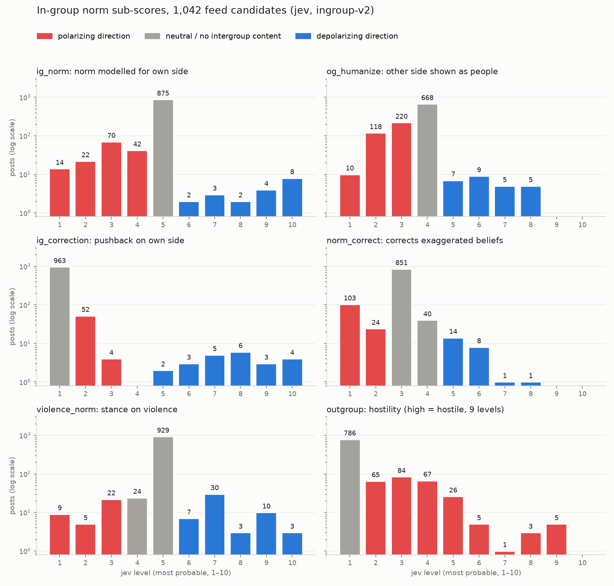

# In-group norm signals in feed candidates (jev, 2026-10-12)

**Question.** You & Lee (2024, *PNAS Nexus*) show that partisans' perception of
their *own* group's norm of hostility toward the out-group is exaggerated and
predicts affective polarization 8.4× better than outgroup meta-perception (and
52% vs 0% of the variance in support for partisan violence); correcting it
reduced polarization. Blair et al. (2025) find the within-group route works
where cross-partisan contact does not. So: how often do feed candidates carry a
post in which an in-group voice signals a less hostile norm, however faintly,
and can jev find them?

**Pool.** 1,042 raw GreenEarth candidates, 2026-10-12, two pools
(pkreissel.eurosky.social 572, aoc.bsky.social 470), cut at the feed's minWords
gate only — *no* MiniLM shortlist, so the pool is not pre-tilted toward LoC.
~16% German. `research/ingroup_norm/collect_candidates.ts`.

**Teacher.** TypeSafe `jev-latest`, rubric `ingroup-v2`
(`research/ingroup_norm/ingroup_questions.py`), one request per post. 1,042
asked, 0 errors, 3.66M input tokens, **$0.15** (v1 pilot run: a further $0.18).
LoC rode along where the ledger lacked it; all rows are in the shared ledger.
No human labels exist for this axis — every precision number below is one
reader's (Claude's) judgement of the post text, not a gold set.

## Sub-scores

Every Score has 10 levels (the API maximum), each a self-contained situation,
reported 1–10. Bipolar scales put "no intergroup content" in the middle; the
upper half is spent on faint signals (a "to be fair", a "not all of them", one
decent word for someone on the other side) before any explicit call.

| sub-score | what it measures | neutral | mean | levels hit (argmax, 1→10) |
|---|---|---|---|---|
| `ig_norm` | norm toward the out-group the post models for its own side (1 rally to violence … 10 lead own side away from hostility) | 5 | 4.79 | 14 22 70 42 **875** 2 3 2 4 8 |
| `ig_correction` | pushback on hostility from the writer's *own* side | 1 | 1.57 | **963** 52 4 0 2 3 5 6 3 4 |
| `og_humanize` | out-group members shown as reasonable, individual people | 4 | 3.67 | 10 118 220 **668** 7 9 5 5 0 0 |
| `norm_correct` | corrects an exaggerated belief about what a group thinks (the You & Lee intervention) | 3 | 2.96 | 103 24 **851** 40 14 8 1 1 0 0 |
| `violence_norm` | norm toward intergroup violence (1 endorse … 10 ask own side to de-escalate) | 5 | 5.04 | 9 5 22 24 **929** 7 30 3 10 3 |
| `outgroup` | hostility ladder, verbatim from `time_sample/fusion_questions.py` | 1 | 1.75 | **786** 65 84 67 26 5 1 3 5 – |

Plus `ig_speaker` (Noul: writer speaks as one side), `divide` (Choice: which
group divide) and `critic_target` (Choice: whose hostility is criticised).

**The asymmetry is as expected.** Of the 1,042: 510 (49%) touch an intergroup
divide (left/right 180, national 113, migration 54, class/generation 52,
gender 39). On `ig_norm`, 148 posts sit below neutral and 19 above it — **~8
hostile-norm posts for every depolarizing one.** On `og_humanize` 348 are below
neutral, 26 above. `critic_target`: 153 posts criticise the *other* side's
hostility, 43 their *own* side's, 11 hostility in general.

## What jev gets wrong

**v1: condemning the opponent read as an in-group correction.** In v1, 7 of the
top 16 `ig_norm` posts condemned the *other* side's hostility ("Trump is calling
for Minnesotans to attack Somali residents", a Welt columnist calling Bas a
"Sozialstaats-Stalinistin"). In You & Lee's terms that is an in-group *rally*,
the reverse signal. `ig_correction` correlated **+0.48** with `outgroup`
hostility. v2 excludes it explicitly in both rubrics and adds `critic_target`;
the Trump/Somali post fell from `ig_correction` 6+ to 1.3. The +0.48 correlation
did not move, though — the residue is the next problem.

**Whose side the writer is on is mostly not in the text.** `critic_target =
own_side` is right for posts like the Khalil one below, but also fires on
outsiders attacking a party ("'empathieloses Arschloch' ist in der Union
Grundvoraussetzung"). A single post rarely states the writer's camp; jev guesses.
`ig_speaker` (P>0.5 on 261 posts) inherits the same blindness.

**Faint levels are reached, but sparsely.** jev puts nearly all mass on one
level (median `ig_norm` confidence 0.96), so the faint levels act as buckets,
not as a gradient: `ig_norm` 6 ("a faint concession") was chosen twice in
1,042. The continuous part comes from the 27% of posts with confidence < 0.8.

## Can it surface the signal?

Composite: mean of z-scores of `ig_norm`, `og_humanize`, `norm_correct`,
`ig_correction` × P(own or general), ½·`violence_norm`, minus `outgroup`.
Top 30 read by hand:

- **11 clear** — e.g. "Okay, but aside from this, violence doesn't solve
  anything" (#1); polls showing support "across political camps" (#6); Gazans
  telling their lives before the war (#7); "they're scared, they're very
  scared" (#15); keep Russian student visas open (#16); "users here are often
  just as bad about sharing misinformation" (#18, Bluesky correcting Bluesky);
  "what if instead of rushing to respond to Gruber's bait post … we just made a
  little face and kept walking" (#29).
- **8 borderline** — goodwill toward groups that are not a polarized
  out-group (Indigenous Peoples' Day ×3), empathy appeals that are also attacks
  on a commenter (Bas resignation ×2).
- **11 misses** — solidarity or remembrance with no out-group (coming-out day,
  Babyn Jar), diplomacy, a corrected tech hot take, and the
  "Brooks/Ossoff" and "you are not 'losing' Nazis" posts, which are hostile.

So roughly **37% strict / 63% lenient precision in the top 30**, against a base
rate of maybe 1–2% in the pool.

**The strictest You & Lee cases rank badly.** In-group corrections that are
themselves sharp in tone are pushed down by the hostility penalty:
"lot of people whose greatest contribution to freeing Palestine is Posting
suddenly determined to prove Mahmoud Khalil is a Zionist plant" ranks #184;
"Extremely funny of people to think that if you bomb the right data center
right wing activity would cease. That's probably bullshit" ranks #869 (one of
11 Yandex-attack posts in the pool, a single news event). Ranking on
`ig_correction × P(own_side)` alone puts the Khalil post #2 and the data-center
post #12, but that ranking is about half noise from the own-side guess. The
signal the paper is about (*our* side, *less* hostile than you think) and a
civil tone are separate dimensions, and a composite that rewards both
misses the first one whenever the second is absent.

## Takeaways

1. The construct is rare in candidates and the faint end is where it lives:
   strict in-group norm corrections are well under 1% of this pool.
2. jev separates *hostile vs. not* well and *whose* hostility poorly. Any use of
   this axis needs `critic_target` (or author-side information from outside the
   post, e.g. the author's follow graph) — the rubric alone cannot recover it.
3. For a feed, `ig_norm` / the composite is a usable *civility-and-goodwill*
   ranker today (~⅔ lenient precision at the top). It is not yet a You & Lee
   in-group-correction detector; that needs `ig_correction × own-side` with a
   better own-side signal, and a gold set to measure it against.

Files: candidates and scores under `research/data/ingroup_norm/`
(`scores_candidates_2026-10-12.jsonl`, all sub-scores with full level
probabilities); scorer `research/ingroup_norm/score_ingroup.py`.

## Re-run with the in-group fixed as the left (`ingroup-left-v1`)

The feed's readers are mostly left, anti-Trump, anti-AfD, so the second rubric
(`research/ingroup_norm/ingroup_left_questions.py`, fields prefixed `left_`)
names the sides in every question: own side = the left, other side = the right,
whoever wrote the post. Same levels, same pool, 1,027 asked (15 pilot), 0
errors, **$0.15**. `divide` and `outgroup` were not re-asked.
`--rubric left` on `score_ingroup.py`; output `scores_candidates_2026-10-12_left.jsonl`.

- **Who is criticised now has a referent.** `critic_target`: right 165, other
  divide 76, **left 67**, general 7. The left-on-left posts are the ones the
  generic rubric could not find, e.g. "for all this talk of Russian bots being
  defeated by the Yandex strikes I'm still getting the usual Matryoshka emails"
  (rank 57; generic: not flagged), a left account hosting AfD voters overnight
  ("AfD-Wähler als Übernachtungsgäste", rank 28).
- **New failure: in-group criticism has a direction, and `ig_correction` ignores
  it.** Much of the left's criticism of the left demands *more* hostility:
  "Dawg you are not 'losing' Nazis" (`left_ig_correction` 5.7, composite #9),
  "several leading left intellectuals spent the first Trump term claiming that
  the admin wasn't fascist" (#15), "what if they are, literally, nazis?". You &
  Lee's mechanism runs the other way; these posts *raise* the perceived
  in-group hostility norm. `ig_correction` still correlates +0.45 with
  `outgroup`.
- **Top-30 precision did not move**: 10 strict / 16 lenient (generic: 11 / 19),
  but the hits are now on the left-right divide (Seehofer credited by a left
  writer, cross-camp poll support, "Hier wird scharf geschossen, beendet das
  doch bitte") rather than Indigenous Peoples' Day and diplomacy.
- Sharp-toned self-corrections are still buried by the hostility penalty
  (Khalil #739, "bomb the right data center … probably bullshit" #817).
- The scores move together across rubrics (r = 0.81–0.91 per sub-score), so the
  side framing re-sorts the intergroup tail without changing the bulk.

